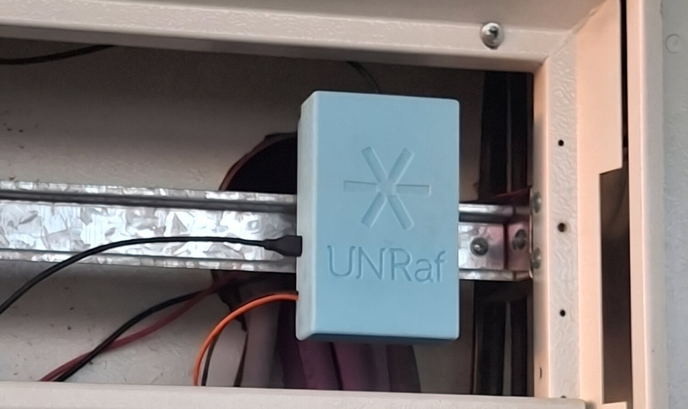

## What it is about

AURA is a Universidad Nacional de Rafaela project to manage building resources and access control with IoT devices. Each Computer Engineering group develops one device: the board firmware and the connector that processes its data inside the platform.

My group took on the node that measures the level of the **two water tanks on the roof of Building 1** (1000 L and 500 L). It has been installed outdoors since October 2026 and sends its readings over LoRaWAN, because the building's indoor network does not reach the rooftop.

## What it does

- **Measures the distance to the water** in each tank with a submersible ultrasonic sensor (JSN-SR04T), using a single Seeed XIAO ESP32-S3 board and an SX1262 radio.
- **Connects over LoRaWAN** (OTAA, class C) to ChirpStack. Being class C, it listens all the time, so commands arrive within seconds.
- **Is configured remotely:** the platform can request an immediate reading (`medir_ahora`) or change the reading interval (`set_config`), which is stored in non-volatile memory.
- **Computes level and volume on the platform**, with a Python connector, and alerts once when a tank drops below 20% and when it reaches 95%.

## Technical decisions

- **The board only sends the distance.** The first version computed percentage and liters in the firmware. We moved that to the connector so we can fix a tank's dimensions, or reuse the node on another tank, without reflashing the board, and so history can be recalculated.
- **Compact binary protocol:** a reading travels in 4 bytes and a ChirpStack codec turns it into platform data, following an MQTT contract shared by all devices.
- **Robustness in a hard-to-reach place:** if the network join fails, the board retries on its own every 5 minutes, and it saves the LoRaWAN session so it does not join from scratch after every reboot. A repeated command is not applied twice, and if a sensor fails no value is made up.
- **Tested connector**, which can be run without the board.

## What I learned

- ESP32 firmware with LoRaWAN: joining the network, device classes, receive windows and transmission limits.
- Designing a protocol between a device and a platform, and deciding which logic goes on the board and which on the server.
- Working in a repository shared by many groups, with a contract, code review and CI.
