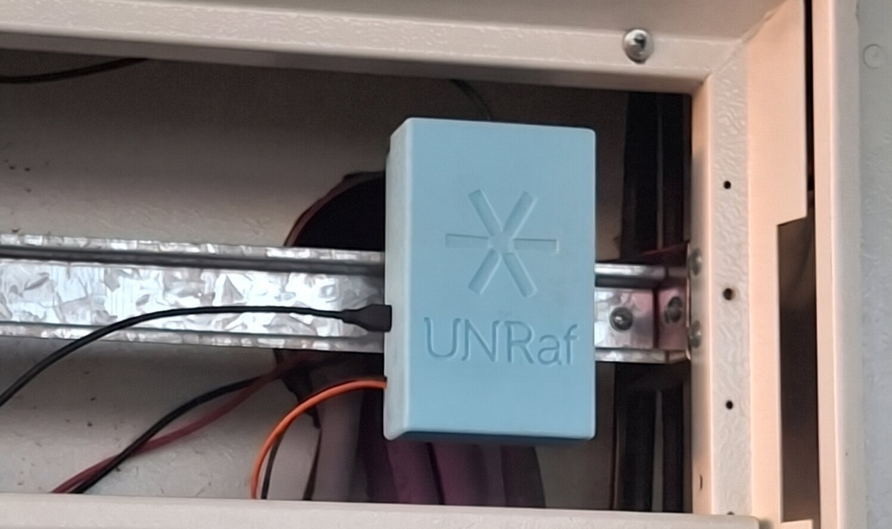

## De qué se trata

AURA es el proyecto de la Universidad Nacional de Rafaela para administrar recursos y accesos del edificio con dispositivos IoT. Cada grupo de Ingeniería en Computación desarrolla un dispositivo: el firmware de la placa y el conector que procesa sus datos dentro de la plataforma.

Mi grupo se encargó del nodo que mide el nivel de los **dos tanques de agua de la terraza del Edificio 1** (1000 L y 500 L). Está instalado al aire libre desde octubre de 2026 y manda sus mediciones por LoRaWAN, porque en la terraza no llega la red interior del edificio.

## Qué hace

- **Mide la distancia al agua** de cada tanque con un sensor ultrasónico sumergible (JSN-SR04T), con una sola placa Seeed XIAO ESP32-S3 y una radio SX1262.
- **Se conecta por LoRaWAN** (OTAA, clase C) con ChirpStack. Como es clase C, escucha todo el tiempo y los comandos llegan en segundos.
- **Se configura a distancia:** desde la plataforma se le puede pedir una medición inmediata (`medir_ahora`) o cambiar el intervalo de lectura (`set_config`), que queda guardado en memoria no volátil.
- **Calcula nivel y volumen en la plataforma**, con un conector en Python, y avisa una sola vez cuando un tanque baja del 20 % y cuando llega al 95 %.

## Decisiones técnicas

- **La placa manda solo la distancia.** La primera versión calculaba porcentaje y litros en el firmware. Lo pasamos al conector para poder corregir las medidas de un tanque, o usar el nodo en otro, sin reflashear la placa, y para poder recalcular el historial.
- **Protocolo binario compacto:** la medición viaja en 4 bytes y un codec de ChirpStack la convierte en datos para la plataforma, según un contrato MQTT común a todos los dispositivos.
- **Robustez en un lugar al que no se llega fácil:** si el join a la red falla, la placa reintenta sola cada 5 minutos, y guarda la sesión LoRaWAN para no unirse de cero en cada reinicio. Un comando repetido no se aplica dos veces, y si un sensor falla no se inventa ningún valor.
- **Conector con tests**, que se prueba sin la placa.

## Qué aprendí

- Firmware para ESP32 con LoRaWAN: unirse a la red, manejar clases, ventanas de recepción y límites de envío.
- Diseñar un protocolo entre un dispositivo y una plataforma, y decidir qué lógica va en la placa y cuál en el servidor.
- Trabajar en un repositorio compartido por muchos grupos, con contrato, revisión de código y CI.
